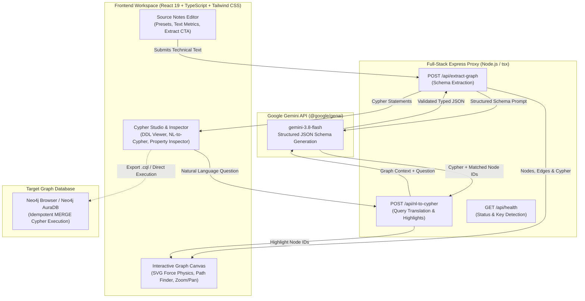

# GraphQuery Lens (Technical Text to Knowledge Graph & Cypher)

> **Full-Stack Developer Tool**: Transform unstructured system architecture notes, incident postmortems, and API documentation into an interactive, high-density knowledge graph with production-grade Neo4j Cypher statements and natural-language query translation. Powered by **Google Gemini 3.8 Flash** (`@google/genai`).

---

## 1. Overview & Core Features

- **Automated Entity & Relationship Extraction**: Ingests raw architecture specs, RFCs, and incident logs to extract strongly typed entities (`SERVICE`, `DATABASE`, `QUEUE`, `GATEWAY`, `CACHE`, `CLIENT`, `INFRASTRUCTURE`, `MONITORING`, `STORAGE`) and directed edges.
- **Neo4j Cypher Synthesis**: Generates idempotent Cypher statements (`CREATE CONSTRAINT`, `MERGE` nodes with `ON CREATE SET`, and `MERGE` edges) ready for copy-pasting or direct execution in Neo4j Browser and AuraDB.
- **Interactive SVG/Canvas Visualizer**:
  - **Dynamic Physics**: Force-directed simulation with Verlet integration, link spring tension, and charge repulsion.
  - **Layout Presets**: Force-Directed, Hierarchical (topological DAG layering), and Radial (concentric hub-and-spoke).
  - **Shortest-Path Finder**: Click any Source and Target node to compute and highlight the optimal traversal path with animated neon flow pulses.
  - **Pan, Zoom & Drag**: Full viewport navigation, fit-to-screen, and drag-and-drop node pinning.
  - **Category Filtering & Search**: Instant filter by entity category or substring search across labels and properties.
- **Natural Language to Cypher Translator**: Ask queries like *"Which services are single points of failure without failover replicas?"* or *"Find all queues connected to stream processors"*. Gemini 3.8 Flash translates the question into idiomatic Cypher and dynamically highlights matching nodes and edges in the canvas.
- **One-Click Sample Presets**:
  - **Distributed IoT Telemetry Pipeline** (Edge Gateways, EMQX MQTT, Apache Kafka, Apache Flink, TimescaleDB, Redis, ML Anomaly Detector, Grafana).
  - **Microservices Incident Postmortem (SEV-1)** (Profile Service bad deployment, PgBouncer pooler exhaustion, Postgres 100% CPU, Auth timeouts, Circuit Breaker trip).
  - **Cloud-Native Serverless Architecture** (CloudFront, API Gateway, Lambda Authorizer, DynamoDB Single-Table, EventBridge Bus, SQS, OpenSearch).
- **Export & Portability**: Download `.cql` Cypher scripts, export complete graph JSON schemas, or capture standalone vector SVG snapshots.

---

## 2. Mermaid System Architecture Diagram



---

## 3. Sample Neo4j Cypher Output

The following is an excerpt of the generated Neo4j Cypher script modeling the **Distributed IoT Telemetry Pipeline**:

```cypher
// 1. Constraints & Unique Indexes
CREATE CONSTRAINT node_id_unique IF NOT EXISTS FOR (n:Entity) REQUIRE n.id IS UNIQUE;

// 2. Entity Node Definitions (Idempotent MERGE)
MERGE (c:Client {id: "iot_fleet"})
  ON CREATE SET c.name = "IoT Sensor Fleet", c.type = "CLIENT", c.count = "50,000+", c.protocol = "MQTT/TLS"
  ON MATCH SET c.updatedAt = datetime();

MERGE (gw1:Gateway {id: "edge_gateway"})
  ON CREATE SET gw1.name = "Edge Gateway Cluster", gw1.type = "GATEWAY", gw1.instances = 24, gw1.redundancy = "N+1";

MERGE (gw2:Gateway {id: "emqx_broker"})
  ON CREATE SET gw2.name = "EMQX MQTT Broker", gw2.type = "GATEWAY", gw2.qos = 1, gw2.connections = "120k peak";

MERGE (q:Queue {id: "kafka_ingest"})
  ON CREATE SET q.name = "Kafka Ingestion Cluster", q.type = "QUEUE", q.partitions = 32, q.throughput = "85MB/s";

MERGE (s1:Service {id: "flink_stream"})
  ON CREATE SET s1.name = "Apache Flink Engine", s1.type = "SERVICE", s1.parallelism = 16, s1.stateBackend = "RocksDB";

MERGE (cache:Cache {id: "redis_cache"})
  ON CREATE SET cache.name = "Redis Real-Time Cache", cache.type = "CACHE", cache.memoryLimit = "64GB";

MERGE (db:Database {id: "timescale_db"})
  ON CREATE SET db.name = "TimescaleDB Hypertable", db.type = "DATABASE", db.engine = "PostgreSQL 16", db.retention = 90;

MERGE (s2:Service {id: "anomaly_detector"})
  ON CREATE SET s2.name = "ML Anomaly Detector", s2.type = "SERVICE", s2.model = "Isolation Forest v2.4", s2.thresholdZScore = 3.2;

MERGE (mon:Monitoring {id: "grafana_alerts"})
  ON CREATE SET mon.name = "Grafana Alert Manager", mon.type = "MONITORING", mon.oncallPager = "Enabled";

MERGE (st:Storage {id: "s3_cold_archive"})
  ON CREATE SET st.name = "S3 Cold Telemetry Lake", st.type = "STORAGE", st.format = "Apache Parquet", st.lifecycle = "7yr";

// 3. Idempotent Relationship Bindings
MATCH (a {id: "iot_fleet"}), (b {id: "edge_gateway"})
MERGE (a)-[r:TRANSMITS_TO {frequency: "Continuous", cipher: "AES-256-GCM"}]->(b);

MATCH (a {id: "edge_gateway"}), (b {id: "emqx_broker"})
MERGE (a)-[r:PUBLISHES_MQTT {qos: "QoS 1"}]->(b);

MATCH (a {id: "emqx_broker"}), (b {id: "kafka_ingest"})
MERGE (a)-[r:STREAMS_INTO {batch_size: "16KB"}]->(b);

MATCH (a {id: "kafka_ingest"}), (b {id: "flink_stream"})
MERGE (a)-[r:CONSUMED_BY {semantics: "Exactly-Once"}]->(b);

MATCH (a {id: "flink_stream"}), (b {id: "redis_cache"})
MERGE (a)-[r:UPDATES_HOT_METRIC {ttl_seconds: 300}]->(b);

MATCH (a {id: "flink_stream"}), (b {id: "timescale_db"})
MERGE (a)-[r:PERSISTS_TIME_SERIES {batch_timeout_ms: 500}]->(b);

MATCH (a {id: "flink_stream"}), (b {id: "anomaly_detector"})
MERGE (a)-[r:EVALUATES_ANOMALY {queue_depth_cap: 1000}]->(b);

MATCH (a {id: "anomaly_detector"}), (b {id: "grafana_alerts"})
MERGE (a)-[r:TRIGGERS_INCIDENT {severity: "CRITICAL"}]->(b);

MATCH (a {id: "timescale_db"}), (b {id: "s3_cold_archive"})
MERGE (a)-[r:BATCH_EXPORTS_TO {frequency: "Daily 02:00 UTC"}]->(b);
```

---

## 4. Environment Configuration & Setup (`.env.example`)

### Prerequisites
- Node.js 20+
- Google Gemini API Key from [Google AI Studio](https://aistudio.google.com/)

### Environment Variables
Copy `.env.example` to `.env`:

```bash
cp .env.example .env
```

Set your `GEMINI_API_KEY`:

```env
# GEMINI_API_KEY: Required for server-side Gemini 3.8 Flash model calls.
# In Google AI Studio Build, this is automatically injected into process.env from user secrets.
# When running locally, obtain a free API key at https://aistudio.google.com/
GEMINI_API_KEY="AIzaSyYourActualGeminiApiKeyGoesHere"

# Server Port (Default is 3000)
PORT=3000

# Optional app URL for self-referential links
APP_URL="http://localhost:3000"
```

### Installation & Run

```bash
# Install dependencies
npm install

# Start the full-stack development server on port 3000
npm run dev

# Build for production
npm run build

# Start production server
npm run start
```

---

## 5. Technology Stack

- **Frontend**: React 19, TypeScript, Tailwind CSS v4, Lucide React icons, Motion
- **Visualization**: Custom SVG/Canvas Force Simulation with Verlet integration & D3-inspired spring physics
- **Backend**: Node.js, Express, tsx
- **AI Engine**: `@google/genai` (SDK v3.2.0), model `gemini-3.8-flash` with strict structured JSON schemas (`responseMimeType: "application/json"`)
